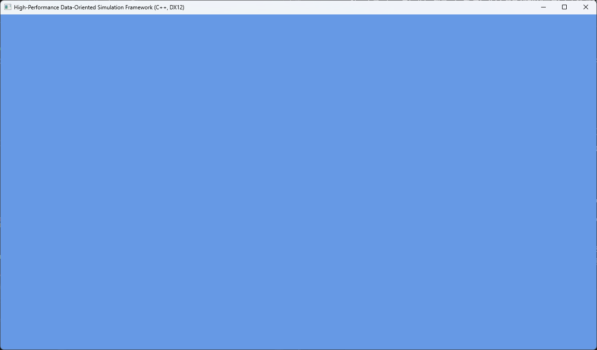

# DX12 High-Performance Renderer

> **"A high-performance, low-level DirectX 12 renderer designed to maximize hardware utilization through explicit resource management and multi-threaded command recording via a custom Job System."**

---

## 🛠 Core Engineering Principles

* **Explicit Hardware Control:** Bypassing driver abstraction for direct GPU memory and synchronization management.
* **Modern Threading Model:** Parallelized command list generation to eliminate CPU-side bottlenecks.
* **Static Analysis Driven:** Zero-warning build achieved through rigorous memory diagnostics and SAL annotations.

#### **Issue: Character Encoding Conflict (Unicode vs ANSI)**

- **Problem:** `OutputDebugString` 및 `sprintf_s` 호출 시 `char*`와 `LPCWSTR` 간의 형 변환 에러(`C2664`) 발생.

- **Cause:** 현대적인 윈도우 환경(Unicode)과 튜토리얼 코드(ANSI) 간의 인코딩 불일치.

- **Solution:** * 1바이트 기반 `sprintf_s`를 와이드 문자용 **`swprintf_s`**로 교체.
  
  - 문자열 리터럴 앞에 **`L`** 매크로를 사용하여 2바이트 문자열임을 명시.
  
  - `OutputDebugStringW`와의 호환성을 확보하여 디버그 로그 시스템 안정화.

- **Takeaway:** 시스템 프로그래밍에서 문자열 인코딩 체계가 메모리 레이아웃 및 API 호환성에 미치는 영향 파악.

- 

#### **Issue: Uninitialized Memory Warning (C6001/C6387)**

`d3dx12.h` 내부의 `D3DX12SerializeVersionedRootSignature` 함수 빌드 시, `HeapAlloc`으로 할당된 메모리를 초기화 없이 사용하여 `DescriptorTable.pDescriptorRanges` 등에서 "초기화되지 않은 메모리 사용" 경고 발생.

#### **Technical Deep Dive & Analysis**

1. **Memory Allocation Behavior:** MS의 헬퍼 라이브러리는 성능 최적화를 위해 `HeapAlloc`의 플래그를 `0`으로 설정, 메모리 제로화(Zero-initialization) 과정을 생략함. 이로 인해 할당된 메모리 블록에 '쓰레기 값(Garbage Value)'이 잔존함.

2. **Union Structure Conflict:** `D3D12_ROOT_PARAMETER`는 유니온(Union) 구조를 가지는데, 특정 타입이 아닐 경우 일부 포인터 필드가 채워지지 않은 채 남게 됨. 정적 분석기(Static Analyzer)는 이를 잠재적인 런타임 Null 포인터 참조나 잘못된 주소 접근으로 판단하여 경고를 발생시킴.

#### **Engineering Decision: Suppression over Modification**

라이브러리 소스 코드를 직접 수정하여 경고를 없앨 수 있었으나, 다음과 같은 이유로 기존의 방식을 채택함:

- **Portability (이식성):** 외부 라이브러리 소스 자체를 수정할 경우, 다른 환경에서 프로젝트를 빌드하거나 라이브러리를 업데이트할 때 '수정 사항 누락'으로 인한 일관성 결여 문제가 발생함.

- **Maintenance (유지보수):** 표준 라이브러리의 무결성(Integrity)을 유지하면서 우리 프로젝트의 빌드 규칙만 적용하는 것이 실무적인 정석임.

- **Performance vs. Safety:** 해당 경고는 MS 엔지니어들이 의도한 성능 최적화 결과물이며, `switch` 문을 통해 논리적으로 안전하게 보호되고 있음을 확인 후 오탐(False Positive)으로 간주함.

### **Issue: Static Analysis Warning C6387 (LoadIconW)**

- **Problem:** `LoadIconW` 호출 시 두 번째 인자(`lpIconName`)가 `0(NULL)`일 수 있다는 정적 분석 경고 발생.

- **Cause:** `LoadIcon` 함수는 첫 번째 인자가 `hInst`일 경우 두 번째 인자로 유효한 리소스 이름을 기대함. `NULL`을 전달할 경우 함수는 실패하여 `NULL` 핸들을 반환하지만, `RegisterClassEx` 단계에서 운영체제가 기본 아이콘으로 자동 대체(Fail-safe)해주기 때문에 겉으로는 정상 작동하는 것처럼 보였던 것임.

- **Solution:** * 운영체제의 기본 아이콘을 명시적으로 사용하기 위해 첫 번째 인자를 `nullptr`로 변경.
  
  - 두 번째 인자에 표준 아이콘 식별자인 `IDI_APPLICATION`을 전달하여 함수의 의도를 명확히 함.

- **Engineering Insight:** "작동하는 코드"와 "올바른 코드"의 차이를 인지함. 로우레벨 프로그래밍에서는 운영체제의 예외 처리에 의존하기보다, 모든 자원 핸들을 명시적이고 예측 가능한 상태로 제어해야 함을 학습함.

### **Day - 1 Summury : Screen complete**

나중에 쓸거 : 

Utilized Microsoft WRL ComPtr for robust lifetime management of D3D12 objects, preventing potential memory leaks in low-level resource handling.
